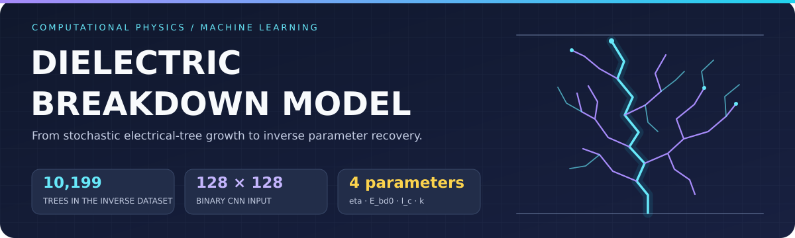
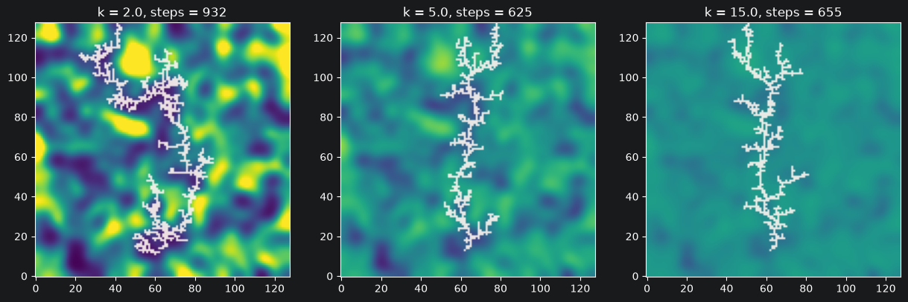
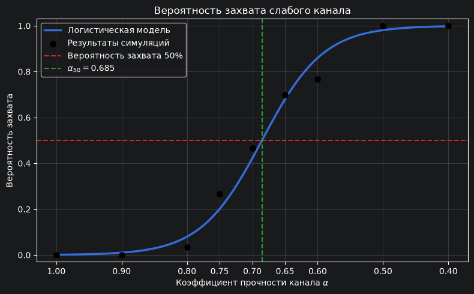
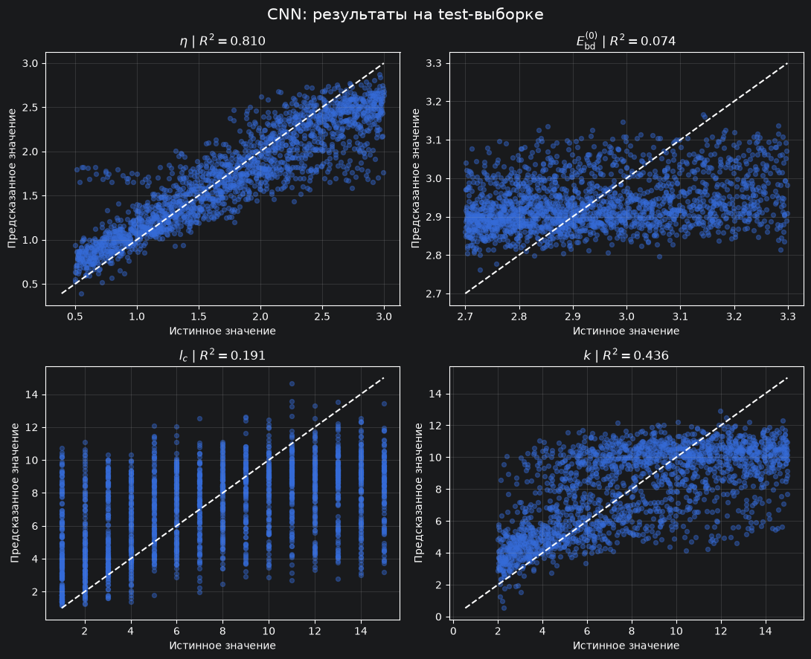
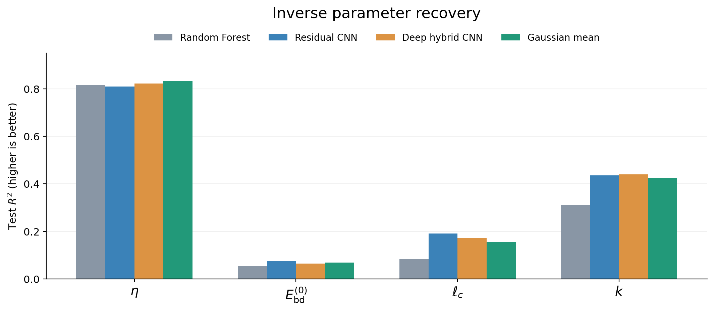

# Dielectric Breakdown Model

**A 2D simulator of electrical-tree growth in heterogeneous dielectrics, with statistical experiments and inverse parameter estimation.**

The project asks how much information about growth and material disorder can be recovered from the final channel geometry. It connects electrostatic simulation, morphology analysis, machine learning, and prediction uncertainty.

**Current findings:** η is recovered well; the threshold scale and correlation length remain difficult. A deeper residual hybrid model gives no general improvement. A Gaussian head adds useful, empirically tested uncertainty intervals.

[Technology stack](#technology-stack) · [Physics](#physical-model) · [Experiments](#experiments-and-forward-learning) · [Inverse models](#inverse-models) · [Test results](#test-results) · [Gaussian inversion](#gaussian-probabilistic-inversion) · [Repository](#repository)

## Technology stack

| Layer | Libraries & technologies | Role in the project |
|---|---|---|
| Numerical simulation | **Python · NumPy · SciPy** | Grid fields, correlated material disorder, connected components and statistical analysis |
| CPU acceleration | **Numba · Joblib** | JIT-compiled SOR electrostatic solver and parallel Monte Carlo runs |
| Data & preprocessing | **pandas · scikit-learn** | Experiment tables, feature preprocessing, grouped evaluation and regression/classification baselines |
| Tabular learning | **scikit-learn · CatBoost** | Logistic regression, Random Forest and gradient boosting for simulation outcomes |
| Deep learning | **PyTorch · CUDA** | Residual CNNs, mask + morphology fusion, Gaussian likelihood training and GPU execution when available |
| Experiments & plots | **Jupyter · Matplotlib · tqdm** | Reproducible notebook workflows, diagnostic figures and training progress |

**Methods:** Laplace/SOR simulation · Sobol sampling · residual learning · Gaussian NLL · validation calibration · paired cluster bootstrap.

The simulator uses CPU acceleration; neural training can run on CUDA in Colab or locally. Fixed seeds, grouped splits, saved preprocessing and model checkpoints connect the experiments to evaluation.

## Physical model

At each growth step, a Numba-accelerated SOR solver computes the Laplace potential around the electrodes, needle, and conducting channel. The electric field determines which neighbouring cells exceed their local strength threshold. One active cell is sampled, the channel expands, and the field is solved again.

Material disorder is constructed from spatially smoothed Gaussian noise, transformed into a Weibull-type strength field. Material randomness (`disorder_seed`) and stochastic growth (`random_seed`) are controlled separately.

| Parameter | Code name | Role |
|---|---|---|
| η | `eta` | Selectivity of growth towards larger field excess |
| E_bd⁽⁰⁾ | `mean_breakdown_field` | Global scale of the local strength threshold |
| ℓc | `correlation_length` | Spatial smoothing scale of disorder, in grid units |
| k | `weibull_shape` | Shape of the strength distribution |

Outcomes are **no initiation**, **arrested growth**, and **breakdown**. Runs reaching the step limit are handled separately in dataset generation.

*Individual realizations from notebook 05; these images do not estimate average parameter effects.*

## Experiments and forward learning

- Monte Carlo runs, Sobol parameter sampling, and adaptive refinement near outcome transitions.
- Controlled straight and Y-shaped weak paths to study channel capture and branch preference.
- Bootstrap, permutation tests, Friedman tests, and Wilcoxon comparisons with Holm correction.
- 27 morphology descriptors: size, depth, transverse spread, branching, path lengths, sinuosity, fractal dimension, lacunarity, and radial mass profiles.
- Forward classifiers: logistic regression, Random Forest, and CatBoost. Evaluation includes probability calibration, log loss, and rare arrested-growth diagnostics.

*Controlled capture experiment from notebook 13. The fitted 50% capture point is approximately α = 0.685 for this setup.*

## Inverse models

**Input:** a binary channel mask, 128 × 128 pixels, or morphology features derived from that mask. **Targets:** η, E_bd⁽⁰⁾, ℓc, and k.

| Split | Masks | Use |
|---|---:|---|
| Train | 6,560 | Fit models and target normalization |
| Validation | 1,706 | Select checkpoints and calibrate uncertainty |
| Test | 1,933 | Evaluate fixed models |

Parameter points are separated by `point_id`. Repeated runs of the same point stay in one split. Metrics are reported separately for each target in its original simulation units.

| Model | Input and architecture |
|---|---|
| Random Forest | 27 morphology features; one forest per target |
| Residual CNN | Mask → four residual blocks → dual pooling → 128-feature embedding → four regression heads |
| Deep hybrid CNN | Mask → eight residual blocks → image embedding; morphology → feature embedding; concatenation → four outputs |
| Gaussian inverse | Frozen original CNN → 128 features → mean and variance heads |

### Deep CNN with skip connections and morphology

The deep hybrid model has **1,793,764 trainable parameters**. It is trained jointly from scratch, combining an image branch with 27 engineered descriptors from the same mask.

| Stage | Architecture |
|---|---|
| Image encoder | Two residual blocks per level; channels 16 → 32 → 64 → 128 |
| Residual block | Two 3 × 3 convolutions, BatchNorm and ReLU; input added through an identity or 1 × 1 projection shortcut |
| Downsampling | MaxPool after each pair of blocks; final maps 128 × 8 × 8 |
| Pooling | Adaptive average and maximum pooling to 4 × 4; concatenate into 4,096 values |
| Image branch | 4,096 → 256 → 128, with ReLU and dropout 0.25 |
| Morphology branch | 27 → 64 → 32, with ReLU |
| Regression head | Concatenate 128 + 32 → 64 → 4, with ReLU and dropout 0.20 |

Each level has four spatial convolutions. Skip connections add the block input to its learned transformation. The descriptors provide an inductive bias; they are not an independent physical measurement.

Training uses standardized targets, SmoothL1 loss, AdamW, learning-rate reduction, and early stopping. The original residual CNN has one block per level and **1,403,332 parameters**.

## Test results

### Point prediction: MAE

| Target | Random Forest | Residual CNN | Deep hybrid CNN | Gaussian mean |
|---|---:|---:|---:|---:|
| η | 0.2276 | 0.2369 | 0.2271 | **0.2160** |
| E_bd⁽⁰⁾ | 0.1374 | **0.1326** | 0.1344 | 0.1335 |
| ℓc | 3.5317 | **3.1719** | 3.2786 | 3.1952 |
| k | 2.5486 | 2.2629 | 2.2677 | **2.2581** |

*Lower is better. Different targets have different scales. Bold values identify numerical minima, not statistically established winners. The final forest was refitted on train + validation; neural models used validation for checkpoint selection.*

*Original test predictions from notebook 19; the diagonal indicates exact recovery.*

### Did deeper convolution improve recovery?

A paired cluster bootstrap resampled **1,401 test parameter points**, retaining their repeated runs: 5,000 resamples over 1,933 masks. Positive MAE differences favour the deep hybrid.

| Target | MAE(CNN) − MAE(deep hybrid) | 95% bootstrap interval |
|---|---:|---|
| η | +0.00979 | [+0.00201, +0.01742] |
| E_bd⁽⁰⁾ | −0.00180 | [−0.00364, +0.00003] |
| ℓc | −0.10662 | [−0.17575, −0.03943] |
| k | −0.00477 | [−0.05083, +0.04105] |

**Result:** a small improvement for η, a deterioration for ℓc, and intervals including zero for the other two targets. Increasing encoder depth and adding morphology did not produce a general improvement. These are pointwise intervals for fixed trained models, without multiple-comparison correction or retraining across seeds.

## Gaussian probabilistic inversion

The Gaussian model uses **128 features from the frozen original CNN**, not the deep hybrid. A shared 128 → 64 ReLU layer feeds two 64 → 4 outputs: means and positive variances. Softplus plus a variance floor ensures positivity. The head has **8,776 trainable parameters**.

Training minimizes Gaussian NLL, summed over four targets and averaged over masks. The output is a diagonal conditional Gaussian approximation: one distribution per parameter, without learned parameter correlations or multiple modes.

An **individual variance** changes with the mask. The **constant baseline** uses one variance per parameter, estimated from training residuals. Both variants use identical Gaussian-head means, isolating the uncertainty comparison.

### Calibration and held-out evaluation

One sigma multiplier per target was fitted by minimizing NLL on validation. The constant baseline received the same calibration procedure. All coefficients were fixed before test evaluation.

| Uncertainty model | Test NLL ↓ |
|---|---:|
| Individual variance | 4.2875 |
| Individual variance, calibrated | **4.1336** |
| Constant variance | 4.5411 |
| Constant variance, calibrated | 4.3970 |

**Result:** individual uncertainty remains useful after calibration, reducing test NLL by **0.2634** relative to the calibrated constant baseline. NLL is measured in normalized target coordinates. Its difference has not been tested for statistical significance.

*Nominal coverage on the horizontal axis, observed test coverage on the vertical axis. The dotted diagonal is ideal calibration; curves below it indicate undercoverage. Orange: individual variance before calibration; blue: after calibration; green: calibrated constant variance. These curves assess multiple interval levels, rather than only the 95% level.*

### Accuracy and calibrated 95% intervals

| Target | MAE | RMSE | R² | Coverage | Mean interval width |
|---|---:|---:|---:|---:|---:|
| η | 0.2160 | 0.2942 | 0.8337 | 95.19% | 1.0880 |
| E_bd⁽⁰⁾ | 0.1335 | 0.1602 | 0.0687 | 96.48% | 0.6311 |
| ℓc | 3.1952 | 4.0984 | 0.1540 | 92.50% | 14.5789 |
| k | 2.2581 | 2.8682 | 0.4241 | 94.88% | 11.0233 |

Coverage is the fraction of true values inside their predicted intervals. It must be read together with interval width and mean-prediction error: wide intervals can cover truth despite poor point recovery.

Calibration moves η and k close to the nominal 95% coverage; ℓc retains undercoverage. Calibration changes interval widths, not mean predictions.

### Three test masks: parameter recovery and intervals

*Each row starts with an observed channel mask. Blue points and bars show predicted means and calibrated marginal 95% intervals; black crosses mark true parameters. The model recovers parameters from masks; it does not generate or reconstruct the masks.*

The third example exposes a failure: the true correlation length is **13**, while the predicted mean is **3.60** and the interval is **[−1.69, 8.88]**. Wide intervals in the other examples also show why coverage alone is insufficient. These three cases illustrate individual predictions; the tables above evaluate all **1,933 test masks**.

**Interpretation:** the Gaussian head adds tested uncertainty estimates, with no general breakthrough in point accuracy. η is recovered well, k moderately, and the threshold scale and correlation length remain difficult. Poor recovery does not by itself prove fundamental physical non-identifiability.

## Scope and limitations

- Results concern synthetic 2D DBM data. Transfer to real dielectric images has not been evaluated.
- The simulator is quasi-static and lattice-based; it does not resolve physical propagation time, transport, heating, or chemical damage.
- A Gaussian approximation can produce nonphysical interval boundaries. Separate marginal 95% intervals do not imply joint 95% coverage, and average coverage does not guarantee calibration for every mask.
- Predicted variance can include mean-model error; it is not a separate estimate of uncertainty in network weights or purely physical ambiguity.
- The test set has been inspected across project iterations. Confirmatory evaluation after further development requires a new locked test.

## Repository

| Location | Contents |
|---|---|
| `src/` | Electrostatics, disorder, growth, morphology, and inverse-model modules |
| `notebooks/` | Physical experiments, statistics, datasets, training, and evaluation |
| [`docs/`](docs/README.md) | Figure provenance, metric tables and plotting scripts |
| `results/` | Locally generated metrics, predictions, and checkpoints |
| `requirements.txt` | Dependencies |

| Notebook | Purpose |
|---|---|
| [13](notebooks/13_controlled_week_path.ipynb), [14](notebooks/14_controlled_y_path.ipynb) | Controlled weak-path experiments |
| [15_dataset_generation.ipynb](notebooks/15_dataset_generation.ipynb) | Sampling and simulation datasets |
| [16_ml_baselines.ipynb](notebooks/16_ml_baselines.ipynb) | Forward outcome prediction |
| [17_morphology_dataset.ipynb](notebooks/17_morphology_dataset.ipynb) | Morphology features and inverse dataset |
| [18_inverse_ml.ipynb](notebooks/18_inverse_ml.ipynb) | Morphology-based Random Forest |
| [19_cnn_inverse.ipynb](notebooks/19_cnn_inverse.ipynb) | Original residual CNN |
| [20_deep_hybrid_inverse.ipynb](notebooks/20_deep_hybrid_inverse.ipynb) | Deep residual hybrid and bootstrap comparison |
| [21_probabilistic_inverse.ipynb](notebooks/21_probabilistic_inverse.ipynb) | Gaussian head, calibration, and test diagnostics |

Datasets, masks, and trained weights are generated locally and may be excluded from version control. The Gaussian inference checkpoint contains CNN/head weights, target normalization, and sigma calibration coefficients.

The R² comparison and example intervals reproduce saved, rounded notebook outputs; calibration curves and mask displays come from the completed notebook figures. See [figure sources and reproduction](docs/README.md). No training or evaluation was rerun for this README.
