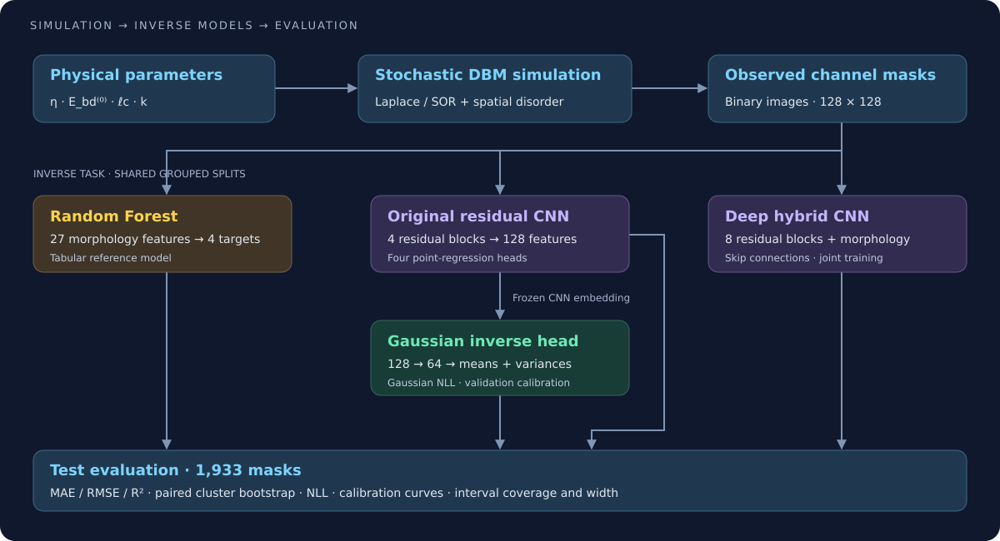

# Documentation and figures

The main [README](../README.md) presents the simulator, technology stack, inverse architectures and completed evaluation. This directory contains its figures and the values used to reproduce summary plots.

## Model documentation

- [Deep hybrid CNN: residual blocks, morphology and test results](deep_hybrid_inverse.md).
- [Gaussian inversion: architecture, calibration and three examples](gaussian_inverse.md).
- [Earlier frozen-embedding hybrid experiment](hybrid_inverse.md).



## Figure sources

| Asset | Source and meaning |
|---|---|
| `images/technology_stack.svg` | Local vector badges for libraries and execution technologies used in the project; no external badge service required. |
| `images/disorder_growth.png` | Notebook 05: channel realizations over material disorder. |
| `images/capture_sigmoid.png` | Notebook 13: controlled weak-path capture experiment. |
| `images/cnn_test_predictions.png` | Notebook 19: original CNN true-versus-predicted test values. |
| `images/inverse_test_r2.png` | R² comparison reconstructed from rounded notebook results. |
| `images/gaussian_test_calibration.png` | Notebook 21: the original four test calibration panels, extracted unchanged from the plot area of the supplied screenshot `image(20261011-193136).png`. Curves were not digitized, interpolated or regenerated. |
| `images/gaussian_test_examples.png` | Notebook 21: three existing examples, replotted using the displayed numerical results and the corresponding mask displays. |

The example rows correspond to `test-001342`, `test-000184` and `test-001580`. Their means, truths and interval endpoints are recorded in [`data/gaussian_test_examples.csv`](data/gaussian_test_examples.csv). The three `data/test_example_mask_*.png` files are unchanged crops of the mask displays in `image(20261011-193359).png`, with the notebook interface excluded. They preserve the available display resolution and are **not the original 128 × 128 model-input arrays**. No masks were generated, and no model was rerun.

The example charts share an axis range for each parameter across all three rows. Negative interval endpoints are retained: they are an actual consequence of the unconstrained Gaussian approximation. Examples illustrate individual successes and errors; use the full test metrics for aggregate conclusions.

## Reproduce the plots

From the repository root, with NumPy and Matplotlib installed:

```bash
python docs/plot_readme_results.py
python docs/plot_gaussian_examples.py
```

The first command recreates the R² chart and the two metric CSV files. The second recreates the three-example figure from the included CSV and mask crops. Neither command runs training or inference. The calibration figure is a preserved notebook output and is not rebuilt from the summary tables: those tables contain only 95% coverage, not the full calibration curves.

| Table | Contents |
|---|---|
| [`inverse_test_summary.csv`](inverse_test_summary.csv) | Per-target MAE and R² for four inverse models. |
| [`gaussian_test_summary.csv`](gaussian_test_summary.csv) | Joint test NLL, per-target 95% coverage and mean interval width for four uncertainty variants. |
| [`data/gaussian_test_examples.csv`](data/gaussian_test_examples.csv) | Three masks × four targets: truth, mean and calibrated interval endpoints. |

Values reproduce rounded notebook outputs. Joint NLL is repeated across target rows for convenience; **do not sum it again**. NLL uses standardized target coordinates, while example intervals and widths use original simulation units.

## Stack and execution

- **NumPy / SciPy:** numerical fields, disorder construction, morphology and statistics.
- **Numba / Joblib:** compiled CPU solver and parallel simulation runs.
- **pandas / scikit-learn / CatBoost:** datasets, preprocessing, grouped evaluation and tabular baselines.
- **PyTorch / CUDA:** residual encoders, deep hybrid regression and the Gaussian head; CUDA requires a compatible runtime.
- **Jupyter / Matplotlib / tqdm:** experiments, scientific figures and progress displays.

The current `requirements.txt` lists the core dependencies. Notebook 16 additionally imports **CatBoost**, which is not listed there; install it separately when reproducing that notebook. Model checkpoints, generated datasets and source mask arrays are not included in this documentation update.
