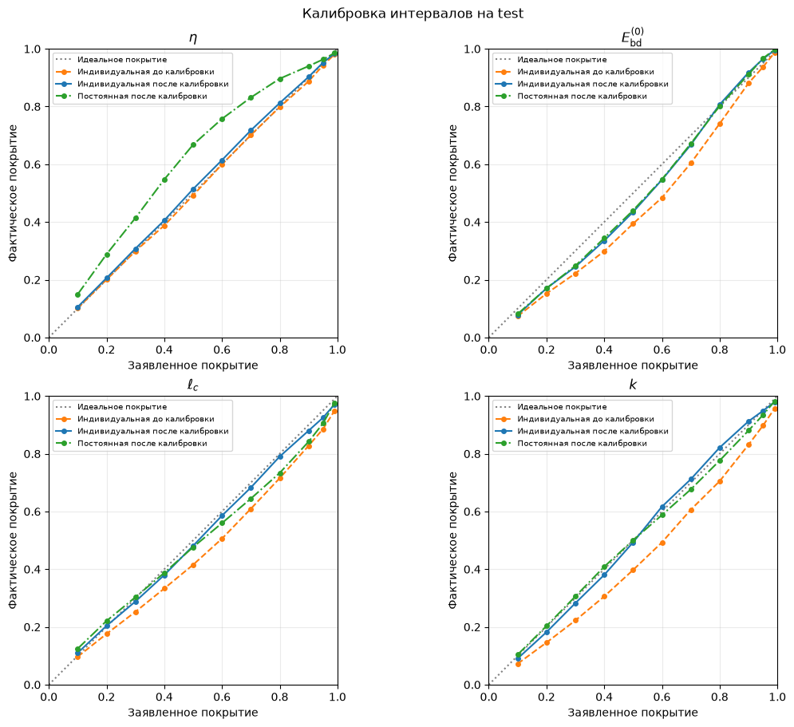
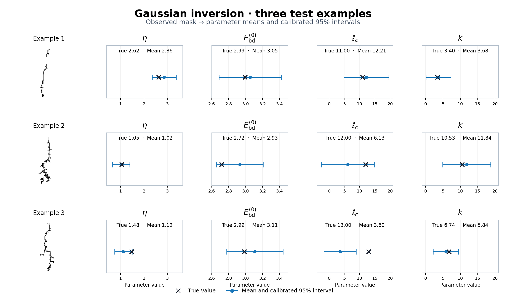

# Гауссовская инверсия

Ноутбук: `notebooks/21_probabilistic_inverse.ipynb`.

Из маски исходная замороженная residual CNN извлекает **128 признаков**. Гауссовская голова преобразует их через Linear 128 → 64 и ReLU в два выхода по четыре числа: средние и дисперсии. Softplus + 10⁻⁶ обеспечивает положительность дисперсий. Обучаются **8776 параметров** головы; функция потерь — Gaussian NLL.

Получается условное нормальное распределение для каждого из четырёх параметров с диагональной ковариацией. Модель восстанавливает параметры по маске, а не генерирует маску. Индивидуальная дисперсия зависит от изображения; постоянная — одинакова для всех изображений при фиксированном параметре.

## Калибровка на test

Множители стандартных отклонений подобраны на validation. Затем модели с индивидуальной и постоянной дисперсией оценены на одних test-масках с одинаковыми предсказанными средними.

Диагональ означает совпадение заявленного и фактического покрытия. Ниже диагонали — интервалы покрывают истинные значения реже заявленного. Оранжевая кривая: индивидуальная дисперсия до калибровки; синяя: после; зелёная: постоянная после калибровки.

| Модель дисперсии | Test NLL ↓ |
|---|---:|
| Индивидуальная | 4.2875 |
| Индивидуальная, калиброванная | **4.1336** |
| Постоянная | 4.5411 |
| Постоянная, калиброванная | 4.3970 |

После калибровки индивидуальная дисперсия уменьшает NLL на **0.2634** относительно постоянной. NLL рассчитан в нормированных координатах; статистическая значимость разницы не проверялась.

| Параметр | R² среднего | Покрытие 95% интервалов | Средняя ширина |
|---|---:|---:|---:|
| η | 0.8337 | 95.19% | 1.0880 |
| E_bd⁽⁰⁾ | 0.0687 | 96.48% | 0.6311 |
| ℓc | 0.1540 | 92.50% | 14.5789 |
| k | 0.4241 | 94.88% | 11.0233 |

## Три примера восстановления параметров по маскам

Слева — входная маска; синим — среднее и калиброванный 95% интервал; чёрным крестом — истинный параметр. В третьем примере ℓc = 13 не попадает в интервал [−1.69, 8.88] при среднем 3.60. Примеры показывают конкретные ошибки; итоговое покрытие рассчитано по всем 1933 test-маскам.

Основной результат — оценка неопределённости, которая зависит от маски и превосходит постоянную дисперсию по наблюдаемому test NLL. Общего скачка точности нет: η восстанавливается хорошо, k умеренно, E_bd⁽⁰⁾ и ℓc остаются сложными. Широкие интервалы и допустимые отрицательные границы отражают ограничения гауссовского приближения. Четыре отдельных 95% интервала не дают совместного 95% покрытия.

[Источники графиков и воспроизведение](README.md#figure-sources)
